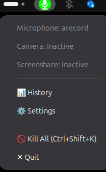
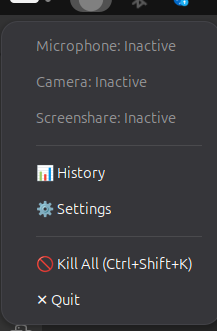
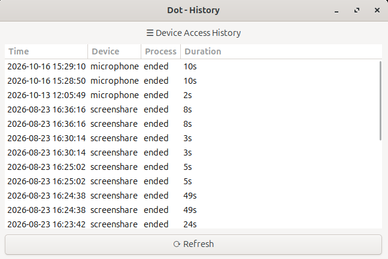
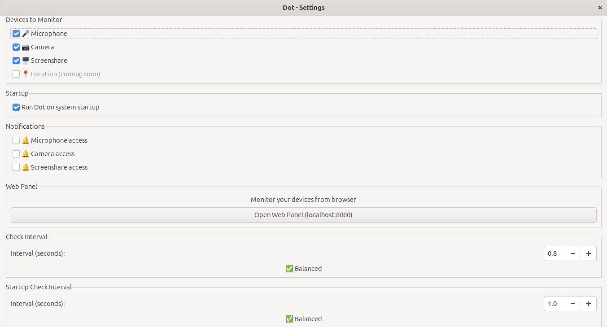
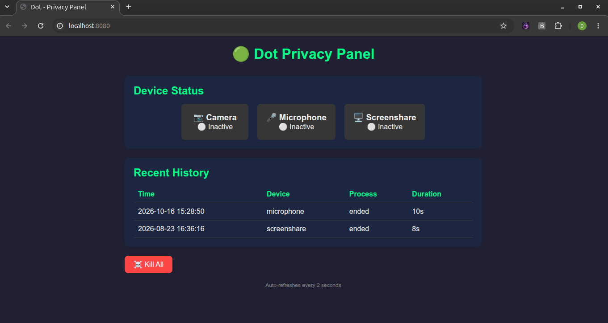
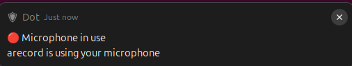

# 🟢 Dot - Privacy Indicator for Linux

> **Take back control of your privacy.**  
> A sleek system tray indicator that shows you exactly when apps are spying through your microphone, camera, screen share.

<p align="center">
  
</p>

---

## ✨ Features

| Feature | Description |
|---------|-------------|
| 🟢 **Green Dot** | A single app is using your device |
| 🟠 **Orange Dot** | Multiple apps are accessing your device simultaneously |
| ⚪ **Gray Dot** | All clear — no activity detected |
| 📊 **History Log** | SQLite database with timestamps, app names, and duration |
| ⚙️ **Settings GUI** | Enable/disable monitoring per device |
| 🎨 **Color Picker** | Built-in color chooser for each indicator state |
| ⏱️ **Configurable Check Interval** | Adjust how often Dot checks for device access (0.1s - 5s) |
| 🚀 **Auto-start Toggle** | Enable/disable run on boot from Settings |
| 🔍 **App Menu Entry** | Search "dot" in Activities to launch |
| 🔒 **Single Instance** | Only one Dot runs at a time |
| 🐧 **Linux Desktop Integration** | Modular desktop integration with desktop-specific startup handling |
| 🛡️ **Secure Installation** | `install.sh` with systemd service and anti-tamper protection (chattr) |
| 🔄 **Auto-Restart** | Automatically restarts if killed or crashed |
| 🔔 **Desktop Notifications** | Get notified when apps access your devices |
| 🔧 **CLI Commands** | Block devices, kill apps, check status from terminal |
| 🌐 **Web Panel** | Monitor devices from browser at localhost:8080 |
| 🚫 **Kill Switch** | `Ctrl+Shift+K` — instantly block all devices |
| 🪟 **All desktop environment** | GNOME, KDE Plasma, Cinnamon, LXQt, Xfce |

---

## 🎯 Why Dot?

Android 12 introduced the famous green dot indicator. iOS has it. Windows has it.  
**Linux desktop didn't — until now.**

Dot monitors **PipeWire/PulseAudio streams** and **video devices** in real-time.
If any app accesses your microphone or camera, you'll know immediately.

---

## 📸 Screenshots

| Tray (Active) | Menu |
|---------------|------|
|  |  |

| History | Settings | Web Panel | Notification |
|---------|----------|-----------|--------------|
|  |  |  |  |

---

## 🛠️ Tech Stack

- **Python 3** — Core logic
- **GTK3 + AppIndicator3** — Native Linux UI
- **SQLite3** — Lightweight local logging
- **PipeWire / D-Bus** — Audio/video stream monitoring
- **psutil** — Process information
- **JSON** — User configuration
- **Cairo** — Color preview rendering

---

## 📦 Installation

### Prerequisites

```bash
sudo apt install gir1.2-appindicator3-0.1 python3-pip python3-venv xdotool python3-gi python3-gi-cairo -y
```

---

### Method 1: Quick Install (Recommended) 🛡️

Installs with systemd service and anti-tamper protection.

```bash
git clone https://github.com/OandONE/dot.git && cd dot/dot
bash install.sh
```

What this does:
- Copies files to `/opt/dot`
- Locks critical files with `chattr +i` (even root can't delete without unlock)
- Creates a systemd service that auto-restarts Dot if killed
- Configures automatic startup through the user's desktop session
- Integrates with desktop environments that do not activate `graphical-session.target`

---

### Method 2: Manual Install

```bash
git clone https://github.com/OandONE/dot.git && cd dot/dot
python3 -m venv .venv --system-site-packages
source .venv/bin/activate
pip install -r ../requirements.txt
python3 main.py
```

---

### After Installation

- Dot appears in your **system tray** (top-right corner)
- Search "Dot" in **Activities** to launch
- Enable **Run on startup** from Settings

---

### Uninstall

```bash
# Remove systemd service
systemctl --user stop dot.service
systemctl --user disable dot.service
rm -f ~/.config/systemd/user/dot.service

# Unlock and remove files
sudo chattr -i /opt/dot/main.py /opt/dot/core/*.py 2>/dev/null
sudo rm -rf /opt/dot

# Remove autostart
rm -f ~/.config/autostart/dot.desktop

# Remove desktop entry
rm -f ~/.local/share/applications/dot.desktop

# Clean temp files
rm -f /tmp/dot.pid /tmp/dot_*.png
```

## 🔧 CLI Commands

Dot comes with a powerful command-line interface:

| Command | Description |
|---------|-------------|
| `dot help` | Show all commands |
| `dot start` | Launch the GUI |
| `dot status` | Show current device status |
| `dot kill` | Kill all apps using devices |
| `dot kill mic` | Kill apps using microphone only |
| `dot kill cam` | Kill apps using camera only |
| `dot block cam` | Disable camera (unload driver) |
| `dot unblock cam` | Re-enable camera |
| `dot block mic` | Mute microphone |
| `dot unblock mic` | Unmute microphone |
| `dot history` | Show access history in terminal |
| `dot settings` | Open Settings window |

> 💡 After install, run `source ~/.bashrc` to activate the `dot` command.

## 🎨 Configuration

Edit `config.json` or use the built-in Settings GUI:

```json
{
    "devices": {
        "camera": true,
        "microphone": true,
        "location": true,
        "screenshare": true
    },
    "settings": {
        "auto_delete_logs": 30,
        "check_interval": 0.8,
        "startup_check_interval": 0.5,
        "auto_start": false
    },
    "notifications": {
        "camera": false,
        "microphone": false,
        "screenshare": false
    }
}
```

## 🚧 Roadmap

### v2.0
- [ ] 📍 **Location monitoring** (GPS / GeoClue)
- [ ] 📈 **Statistics dashboard**
- [ ] 📷 **Fake Camera** (v4l2loopback)
- [ ] 🎨 **Custom themes**
- [ ] 📦 **Debian/Flatpak/Snap** packages
- [ ] 🔒 **Improve security**
- [ ] 🧩 **Plugin/Extension**
- [ ] ☁️ **CD/CI**
- [ ] 🪟 Improve desktop environment integration and expand compatibility testing

---

## 🤝 Contributing

Pull requests are welcome!  
Found a bug? Open an [issue](https://github.com/OandONE/dot/issues).

### Development

```bash
git clone https://github.com/OandONE/dot.git
cd dot/dot
python3 -m venv .venv
source .venv/bin/activate
pip install -r requirements.txt
python3 main.py
```

---

## 📄 License

MIT © [OandONE] (2026)

---

## 🙏 Acknowledgments

- Inspired by Android 12 Privacy Indicators
- Built for the Linux community with ❤️
- Thanks to PipeWire, GTK, and the open-source community

---

<p align="center">
  <sub>If this project helped you, consider giving it a ⭐</sub>
</p>
